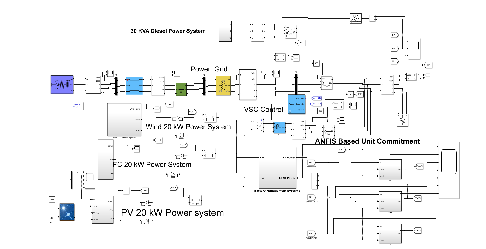

# Microgrid Dispatch Based on Renewable Energy (Simulation with Simulink)

In recent years, environmental issues have been linked to the growth of industrialization, vehicles, and fossil fuel power generation. The primary objective of this research is to focus on the production of various types of uncontaminated alternative fuels for power generation, integrating multiple energy sources. In this study, renewable energy sources such as photovoltaics, wind power, and fuel cells were analyzed under various environmental conditions, while diesel generators were used for independent purposes during main grid failures. Based on the analysis, an MPPT (Maximum Power Point Tracking) controller designed using ANFIS (Adaptive Neuro-Fuzzy Inference System) was developed to generate maximum power from different renewable energy sources and simulated in a Matlab environment. The objective of this paper is to integrate the hybrid integration of various renewable energy sources with energy storage devices and optimal energy commitments based on the ANFIS controller. The design and modeling of the Matlab simulation environment were conducted, and system performance under various conditions was analyzed. Finally, the simulation results were evaluated against the IEEE 1547 standard, demonstrating the effectiveness of the proposed system.

## Images

<!-- PAYMENT_BLOCK -->

## Get this dataset

- Payment link (Stripe): [Buy now](https://buy.stripe.com/3cs8yP7sY87d0vu9AB)
- Payment QR code: 

<!-- /PAYMENT_BLOCK -->
